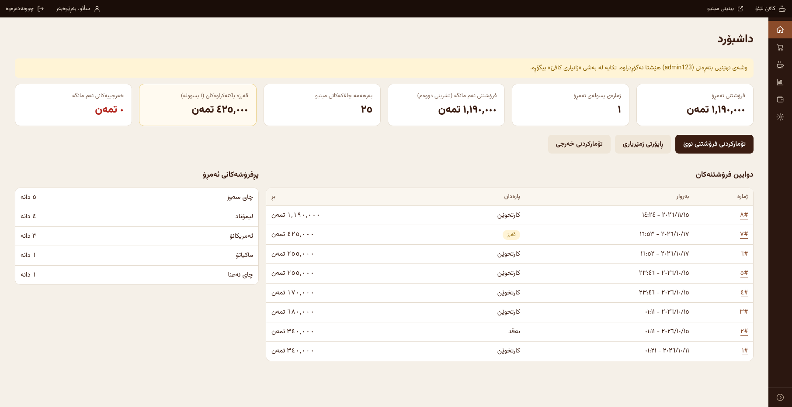
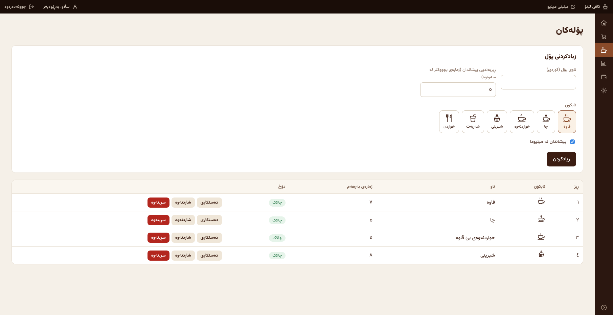
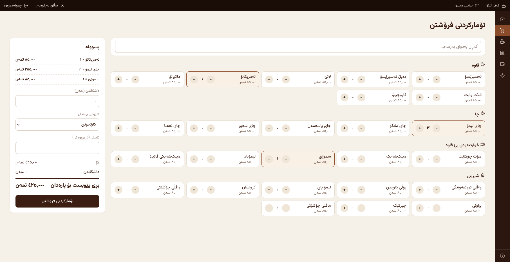

# ماڵپەڕی مینیوی کافێ (PHP + SQLite)

## پێداویستییەکان
- PHP 7.4 یان بەرزتر لەگەڵ ئێکستێنشنەکانی `pdo_sqlite` و `gd` (ئارەزووەکی)
- وێب‌سێرڤەری Apache/Nginx یان بەکارهێنانی ناوخۆیی بە `php -S localhost:8000`

## دامەزراندن
1. فۆڵدەری `cafe` لەسەر هۆست یان سێرڤەر دابنێ (فۆڵدەرەکانی `data/` و `uploads/` دەبێت بنووسرێن).
2. لاپەڕەی سەرەکی: `/index.php`
3. پانێڵی بەڕێوەبردن: `/admin/` — ناوی بەکارهێنەر `admin` و وشەی نهێنیی سەرەتایی `admin123`
   (دەستبەجێ لە بەشی «زانیاری کافێ» وشەی نهێنی بگۆڕە.)

بنکەی دراوە لە یەکەم جار کارپێکردندا خۆکارانە دروست دەبێت و بە داتای نموونەی مینیو پڕ دەکرێتەوە.

## ئیمکانات
- مینیوی گشتی بەپێی دیزاین، بە فۆنتی وەزیرمتن، بەرواری میلادی بە ناوی مانگە کوردییەکان و ڕەقەمی کوردی (٠١٢٣٤٥٦٧٨٩)
- بەڕێوەبردنی پۆلەکان (ناو، ئایکۆن، ڕیزبەندی، پیشاندان/شاردنەوە)
- بەڕێوەبردنی بەرهەم و نرخەکان
- تۆمارکردنی فرۆشتن (سندوق) لەگەڵ داشکاندن و شێوازی پارەدان، چاپکردنی پسوولە
- لیستی فرۆشتنەکان و ڕاپۆرتی ژمێریاری لەگەڵ فلتەری بازەی بەروار (ئەمڕۆ / ئەم هەفتەیە / ئەم مانگە / دڵخواز)
- **یەکەی دراو**: لە بەشی «زانیاری کافێ» دەتوانیت دراو هەڵبژێریت — تمەن، ڕیاڵ، دینار، دۆلار، یۆرۆ، فرانک، پاوەند، یەن، لیرە، یوان، دەرهەم، ڕیاڵی سعودی، دیناری کوەیت، دۆلاری کەنەدا و ئوسترالیا، ڕووبڵ، ڕۆپیە. هەموو نرخ و ڕاپۆرتەکان بەو یەکەیە پیشان دەدرێن.
- بەڕێوەبردنی کاتەکانی کار، ناونیشان، دوو ژمارەی پەیوەندی، ئینستاگرام و ئیمکاناتی کافێ
- دوگمەکانی هاوبەشپێکردن، کۆدی QR و دۆخی شەو/ڕۆژ لە سەرەوەی مینیو (هەڵبژاردنی بەکارهێنەر لە وێبگەڕدا پاشەکەوت دەکرێت)
- بەشی «کۆدی QR ی مینیو» لە پانێڵدا: دیاریکردنی ناونیشان، دەقی ژێر QR، پیشاندان/شاردنەوەی دوگمە، داگرتنی PNG و چاپکردن
- شێوازەکانی پارەدان: کارتخوێن، نەقد، کارت بۆ کارت، ئۆنلاین و قەرز (لەگەڵ تۆمارکردنی ناوی قەرزدار)

